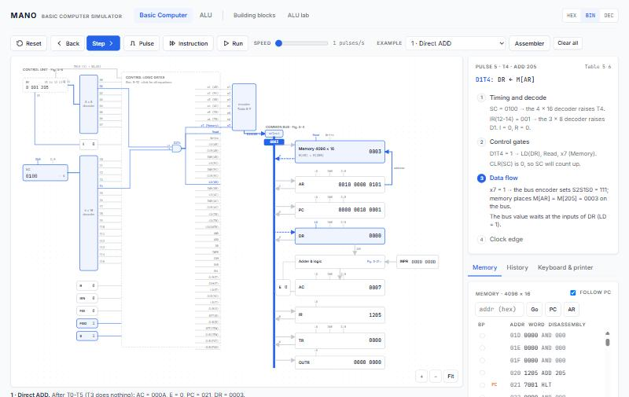
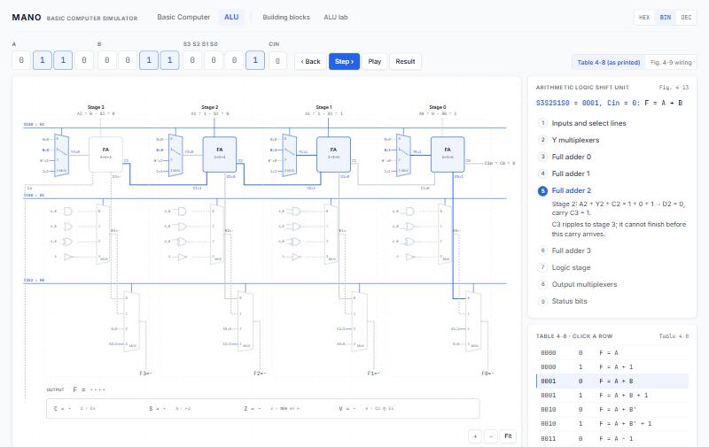
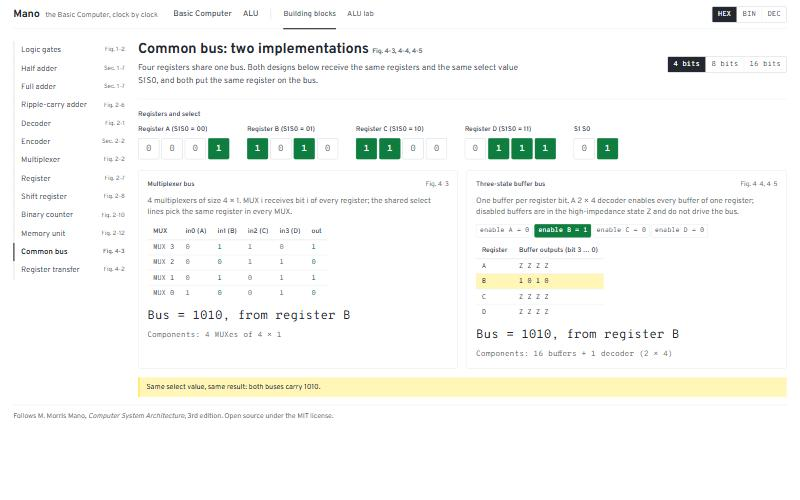

# Mano Basic Computer — Interactive Learning Simulator

A web app that draws the **circuits** of the Basic Computer and the ALU from M. Morris Mano's
*Computer System Architecture* (3rd edition) and lets you watch, **clock pulse by clock pulse**,
which path every signal takes through them.

Everything follows Mano's notation: register names, bus select numbers, RTL such as `M[AR]`,
timing signals T0…T15, the control equations of Sec. 5-10, and figure and table numbers.



## Basic Computer (Ch. 5–6)

One zoomable circuit: the control unit of Fig. 5-6 (IR, the 3 × 8 and 4 × 16 decoders, SC,
flip-flops and the control logic gates), the bus select encoder of Table 5-7, the common bus
and the registers of Fig. 5-4, the memory and the adder-and-logic circuit of Fig. 5-21.

Every clock pulse is shown in **four sub-steps**, in the order the hardware settles:

1. **Timing and decode**: SC drives the 4 × 16 decoder (T0…T15); IR(12-14) drives the 3 × 8 decoder (D0…D7).
2. **Control gates**: the AND gates whose term is 1 (e.g. `D1T4`) light up, wired from the T and D lines to the control outputs they raise (`LD(DR)`, `Read`, `x7`).
3. **Data flow**: the encoder sets S2S1S0, the source drives the bus, and the value travels to the inputs of the registers that will load it.
4. **Clock edge**: every enabled register and flip-flop stores its new value at the same instant.

A side panel explains each sub-step in plain language and shows the Table 5-6 line. Click the
control logic for every equation of Sec. 5-10 with the active terms lit, or the adder-and-logic
block for one stage of Fig. 5-21. You can also step back through the whole history, run at
adjustable speed, edit memory, set breakpoints, type on the keyboard, read the printer, and write
and assemble programs (Ch. 6).

## ALU (Fig. 4-13)

All four stages of the arithmetic logic shift unit, each with its Y multiplexer and full adder,
its logic gates and multiplexer, and its output multiplexer; shared select lines; the carry chain.
Choose A, B, S3S2S1S0 and Cin (or click a row of Table 4-8) and step through the propagation:
Y multiplexers → full adder 0, 1, 2, 3 as the carry ripples → logic stage → output multiplexers → C, S, Z, V.
Wires show their value once it has settled. Both encodings of the arithmetic rows are available
(Table 4-8 as printed, or the Fig. 4-9 wiring of Table 4-4).



## More

- **Building blocks** (Ch. 1–2, Sec. 4-1 to 4-3): gates and NOR-only constructions, adders, decoder, encoder, MUX, clocked registers, shift register, counter, memory, the MUX bus vs. the three-state bus, register transfer.
- **ALU lab** (Sec. 4-4 to 4-7, 8-7): each part of the ALU on its own, with 4, 8 or 16 bits, the 16 logic functions and their applications, all shift microoperations.



### Example programs

One click loads each of these (they are also the automated tests):

1. Direct ADD · 2. Indirect ADD · 3. Indirect LDA · 4. Register-reference INC · 5. BSA call and return ·
6. ISZ loop counter · 7. Add two numbers (assembly) · 8. Subtraction with CMA, INC, ADD · 9. OR with De Morgan ·
10. Echo keyboard to printer · 11. Interrupt-driven input.

## Decisions where the book needed interpreting

- **Reset** clears FGI and sets FGO = 1: "initially, the output flag FGO is set to 1" (Sec. 5-7).
- **Interrupts**: `R ← 1` is evaluated on every pulse with T0'T1'T2'(IEN)(FGI + FGO), in parallel with that pulse's microoperations. Only T0–T2 are qualified by R, so an instruction that sets R always finishes (Fig. 5-13, Table 5-6).
- **Several operation bits** in a register-reference or I/O word all execute in the same T3, with a notice. If several AC circuit inputs are enabled at once, their outputs are ORed, as the AND-OR structure of Fig. 5-21 does. If a register gets more than one of CLR/LD/INR, the priority is CLR, LD, INR (Table 2-4).
- **Table 4-8 vs. Table 4-4**: Table 4-8 lists the arithmetic rows in a different S1S0Cin order than Fig. 4-9 / Table 4-4. The ALU offers both encodings; "as printed" is the default.
- **Assembler addresses** may be labels or hexadecimal numbers; a token that is a defined label is a label.
- **Example 11** starts with FGO = 0 (no printer attached) so that only the keyboard raises interrupts; with FGO = 1 the output flag would request an interrupt immediately after ION.

## Run locally

Requires Node.js 20 or newer.

```bash
npm install
npm run dev       # http://localhost:5173/mano-basic-computer/
npm test          # Vitest: every instruction at pulse granularity, control gates, ALU, assembler
npm run build     # type-check and production build into dist/
```

## Architecture

```
src/core/            pure TypeScript, no React or DOM: fully unit-tested
  bits.ts            word helpers and formatting
  blocks/            gates, adders, decoder, MUX, registers, memory, buses
  alu/               arithmetic, logic, shift circuits, ALU, status bits;
                     aluSteps.ts: per-stage signals and propagation order of Fig. 4-13
  basic/             control unit (control.ts), one clock edge (pulse.ts),
                     controlLogic.ts: the control gate equations of Sec. 5-10,
                     microsteps.ts: a pulse split into its four sub-steps,
                     Fig. 5-21 circuit, disassembler, explanations, Simulator
  assembler/         two-pass assembler (Ch. 6)
  programs/          example programs 1-11
src/ui/
  circuit/           SVG circuit toolkit: pan/zoom canvas, wires, gates, MUX, blocks, pins
  rooms/computer/    Basic Computer circuit page
  rooms/alu/         ALU circuit page and ALU lab sections
  rooms/blocks/      building blocks
```

`controlSignals()` derives every control signal of a pulse from the state *before* the pulse, as
the hardware does; `pulse()` then applies all of them at once on the clock edge. The gate
equations in `controlLogic.ts` are what the drawing shows; a test checks over thousands of states
and every example program that they produce exactly the same signals as `controlSignals()`.
The `Simulator` class adds undo of every pulse, breakpoints, instruction history and the
keyboard/printer devices.

User programs and settings are stored in the browser's local storage.

## Deployment

Pushing to `main` runs `.github/workflows/deploy.yml`: tests, build, and deployment to GitHub Pages.
Enable *Settings → Pages → Source: GitHub Actions* in the repository once.

## Reference

M. Morris Mano, *Computer System Architecture*, 3rd edition, Prentice Hall, 1993.
Chapters 1–2 (digital logic and components), 4 (register transfer and microoperations),
5 (basic computer organization and design), 6 (programming the basic computer) and Sec. 8-7 (status bits).

## License

[MIT](LICENSE)
