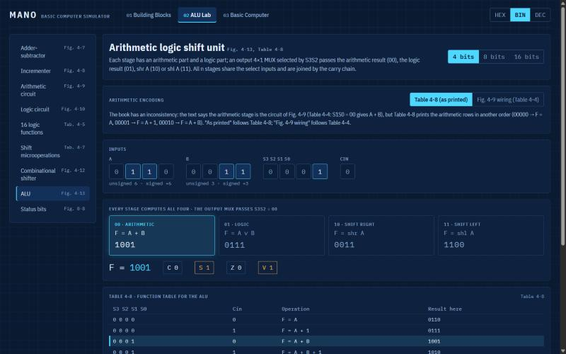

# Mano Basic Computer — Interactive Learning Simulator

A web app that shows, **clock pulse by clock pulse**, how the Basic Computer of M. Morris Mano's
*Computer System Architecture* (3rd edition, Chapter 5) works, together with the building blocks
it is made of (Chapters 2–4) and an assembler for its language (Chapter 6).

Everything follows Mano's notation: register names, bus select numbers, RTL such as `M[AR]`,
timing signals T0…T15, and figure and table numbers, which are shown next to each part of the UI.


## Three rooms

| Room | Book | What you can do |
|---|---|---|
| **01 Building Blocks** | Ch. 1–2, Sec. 4-1 to 4-3 | Toggle inputs of gates (and NOR-only constructions), half/full adders, a ripple-carry adder, decoder, encoder, MUX, clocked register, shift register, counter and memory. Compare the MUX bus and the three-state bus side by side. Watch `R2 ← R1, R1 ← R2` swap on one clock edge. |
| **02 ALU Lab** | Sec. 4-4 to 4-7, 8-7 | Adder-subtractor with C vs. V guidance, incrementer, arithmetic circuit (Table 4-4), logic circuit, all 16 logic functions and their applications, shifts with `ashl` overflow, the combinational shifter, the full ALU of Fig. 4-13 showing every candidate result, and the status bits C, S, Z, V. |
| **03 Basic Computer** | Ch. 5, Ch. 6 | Step one pulse or one instruction, run with adjustable speed, **step back** through the whole history, edit any register, flip-flop or memory word, set breakpoints, type on the keyboard and read the printer, write and assemble programs. |




### At every clock pulse Room 3 shows

- the active timing signal, SC, the decoder output D0…D7 and the flip-flops I, S, E, R, IEN, FGI, FGO;
- the executed lines of **Table 5-6** with their control functions, e.g. `D1T5: AC ← AC + DR, E ← Cout, SC ← 0`;
- the control signals: bus select S2S1S0 and its source, the bus value, LD/INR/CLR of every register, memory read/write and the inputs of the AC adder-and-logic circuit (Fig. 5-21);
- before/after values of everything that changed, on the datapath of Fig. 5-4;
- the memory with PC and AR marked and every word disassembled (`1205 → ADD 205`, `9300 → ADD 300 I`, `7020 → INC`);
- a plain-language **"What happened?"** explanation and the instruction history.

### Example programs

One click loads each of these (they are also the automated tests):

1. Direct ADD · 2. Indirect ADD · 3. Indirect LDA · 4. Register-reference INC · 5. BSA call and return ·
6. ISZ loop counter · 7. Add two numbers (assembly) · 8. Subtraction with CMA, INC, ADD · 9. OR with De Morgan ·
10. Echo keyboard to printer · 11. Interrupt-driven input.

## Decisions where the book needed interpreting

- **Reset** clears FGI and sets FGO = 1: "initially, the output flag FGO is set to 1" (Sec. 5-7).
- **Interrupts**: `R ← 1` is evaluated on every pulse with T0'T1'T2'(IEN)(FGI + FGO), in parallel with that pulse's microoperations. Only T0–T2 are qualified by R, so an instruction that sets R always finishes (Fig. 5-13, Table 5-6).
- **Several operation bits** in a register-reference or I/O word all execute in the same T3, with a notice. If several AC circuit inputs are enabled at once, their outputs are ORed, as the AND-OR structure of Fig. 5-21 does. If a register gets more than one of CLR/LD/INR, the priority is CLR, LD, INR (Table 2-4).
- **Table 4-8 vs. Table 4-4**: Table 4-8 lists the arithmetic rows in a different S1S0Cin order than Fig. 4-9 / Table 4-4. The ALU offers both encodings; "as printed" is the default.
- **Assembler addresses** may be labels or hexadecimal numbers; a token that is a defined label is a label.
- **Example 11** starts with FGO = 0 (no printer attached) so that only the keyboard raises interrupts; with FGO = 1 the output flag would request an interrupt immediately after ION.

## Run locally

Requires Node.js 20 or newer.

```bash
npm install
npm run dev       # http://localhost:5173/mano-basic-computer/
npm test          # Vitest: every instruction at pulse granularity, ALU, assembler, examples
npm run build     # type-check and production build into dist/
```

## Architecture

```
src/core/          pure TypeScript, no React or DOM: fully unit-tested
  bits.ts          word helpers and formatting
  blocks/          gates, adders, decoder, MUX, registers, memory, buses   (Room 1)
  alu/             arithmetic, logic, shift circuits, ALU, status bits     (Room 2)
  basic/           control unit (control.ts), one clock edge (pulse.ts),
                   Fig. 5-21 circuit, disassembler, explanations, Simulator
  assembler/       two-pass assembler (Ch. 6)
  programs/        example programs 1-11
src/ui/            React + Zustand; SVG diagrams; hash routing per room
```

`controlSignals()` derives every control signal of a pulse from the state *before* the pulse, as
the hardware does; `pulse()` then applies all of them at once on the clock edge. The `Simulator`
class adds undo of every pulse, breakpoints, instruction history and the keyboard/printer devices.

User programs and settings are stored in the browser's local storage.

## Deployment

Pushing to `main` runs `.github/workflows/deploy.yml`: tests, build, and deployment to GitHub Pages.
Enable *Settings → Pages → Source: GitHub Actions* in the repository once.

## Reference

M. Morris Mano, *Computer System Architecture*, 3rd edition, Prentice Hall, 1993.
Chapters 1–2 (digital logic and components), 4 (register transfer and microoperations),
5 (basic computer organization and design), 6 (programming the basic computer) and Sec. 8-7 (status bits).

## License

[MIT](LICENSE)
